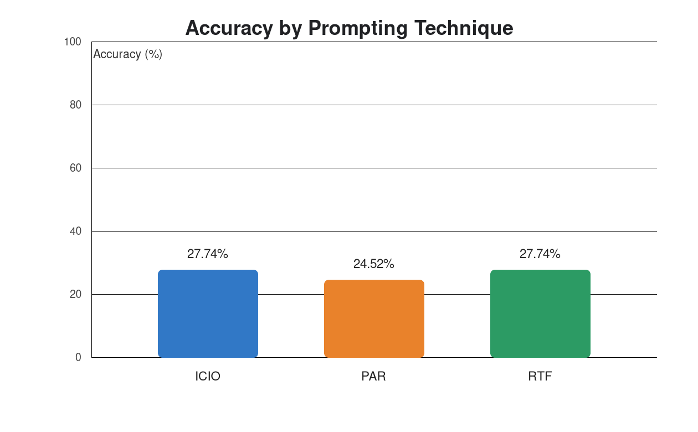

# Task 2: Prompting Technique Comparison

## Objective and method

Compare ICIO, PAR, and RTF for generating SQLite predictions for the 155 questions in `data/restaurants_dataset.csv`. Each technique ran in a fresh Copilot chat session, using the unchanged prompt in `Task_1/prompts/`. The sessions used the same active Copilot chat model by inheriting the current model; the session tooling did not expose its model identifier, so it is reported as unavailable rather than guessed. A sample ICIO query was generated and successfully executed before the full runs.

The database was loaded using the supplied schema and records. Each prediction CSV preserves the source questions and order and has the required `question,predicted_sql` columns. The supplied evaluator was run separately on each prediction file by overriding its prediction path at runtime; the evaluator and source data were not modified. It executes SQL against SQLite and compares result-row multisets, including duplicates.

## Results

| Technique | Correct | Questions | Accuracy | SQL execution errors | Evaluator time | Local script pipeline* |
|---|---:|---:|---:|---:|---:|---:|
| ICIO | 43 | 155 | 27.74% | 0 | 0.153 s | 0.175 s |
| PAR | 38 | 155 | 24.52% | 0 | 0.649 s | 0.905 s |
| RTF | 43 | 155 | 27.74% | 0 | 0.261 s | 0.395 s |

ICIO and RTF tied for the highest measured accuracy; PAR was lower by 3.23 percentage points. These are execution-result accuracies, not SQL-text similarity scores.

## Timing and limitations

Evaluator execution times were measured locally around each evaluator run. The local script pipeline timings include local SQL mapping/construction, database loading, CSV writing, and validation; they exclude the model's response/inference time. PAR's 0.905 s breakdown was 0.082 s for database loading, 0.274 s for SQL construction/CSV writing, and 0.549 s for CSV/query validation.

Model inference time, per-technique end-to-end elapsed time, and average end-to-end elapsed time per question were unavailable: the session interface exposed neither model-generation duration nor reliable per-session start/end timestamps. Those fields are left blank in `experiment_results.csv`. The CSV also provides local-pipeline averages per question, which should not be interpreted as model latency or total elapsed time.

The active model identifier was not exposed by the Copilot session tooling. The same active model was inherited for all three fresh sessions, but its exact identifier cannot be independently recorded. The original prompts were verified unchanged by SHA-256 before and after generation:

- ICIO: `8c4bf59219e87a3a5ee4155a283b358b82d3fc17ecfaa276ecf012d4182a2ca8`
- PAR: `fa4a379b15aa61e02504b283b3a46021bcb4a6170ae0cf9620e70337a0c89c73`
- RTF: `698c6ae02186ecc3f5fef52bd787430bdba0893ae6d14774e40c3ffbd9e34834`
